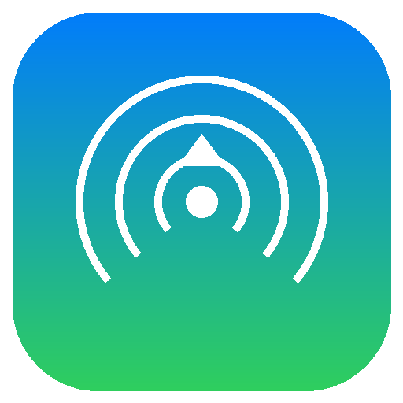
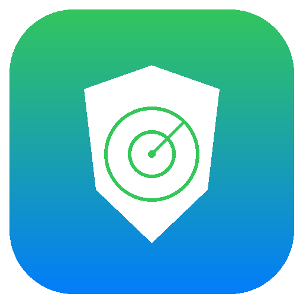
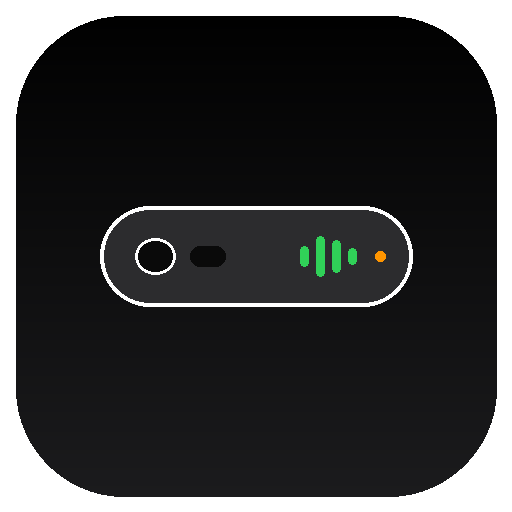
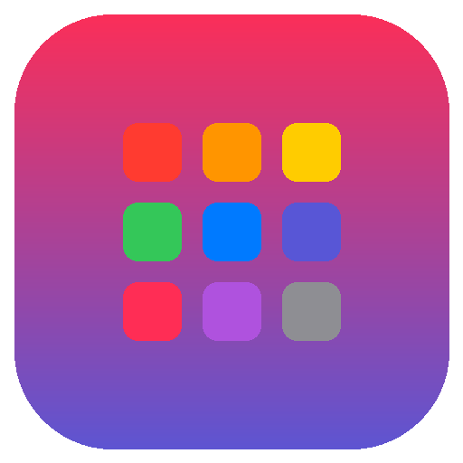
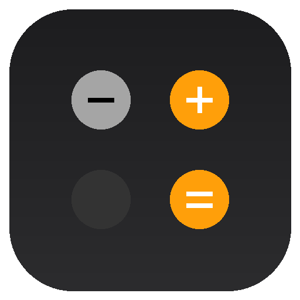
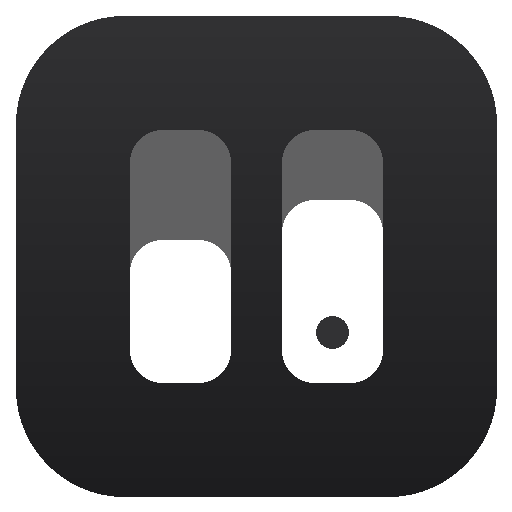

# 🍏 IOSonDroid: The iOS-to-Android F-Droid Repository

[](LICENSE)
[](https://f-droid.org)
[](https://android.com)
[](#-curated-app-catalog)

**IOSonDroid** is a curated, cryptographically signed [F-Droid](https://f-droid.org)-compatible third-party repository bringing **iOS-exclusive applications, Apple ecosystem bridges, and Cupertino system recreations** natively to Android devices.

Whether you want to emulate early iPhone OS games, send and receive Apple iMessages and AirDrop files, protect yourself against unauthorized AirTag tracking, or use Apple's Dynamic Island and Cupertino stock apps on Android, **IOSonDroid** serves all verified packages in one unified place.

---

## 📱 Quick Setup (Add to your Android Device)

### Option 1: One-Click Add
If you have **F-Droid**, **Neo Store**, or **Droid-ify** installed, tap the link below on your phone:

👉 **[Add IOSonDroid to F-Droid](fdroidrepos://pratech1015.github.io/IOSonDroid/repo?fingerprint=33F66FBCA58FC049A8D3E264E7AF414530DC8329D83BFBD9FCF0F3337879E5E0)**

---

### Option 2: Scan QR Code or Add Manually

1. Open your client (**F-Droid**, **Neo Store**, or **Droid-ify**).
2. Go to **Settings** &gt; **Repositories** &gt; **+ (Add)**.
3. Enter the Repository URL:
   ```text
   https://pratech1015.github.io/IOSonDroid/repo
   ```
4. Verify the signing certificate SHA-256 fingerprint:
   ```text
   33F66FBCA58FC049A8D3E264E7AF414530DC8329D83BFBD9FCF0F3337879E5E0
   ```
5. Tap **Add** and pull down to refresh the package index.

---

## 📦 Curated App Catalog

| Icon | App Name | Category | What it Brings to Android | Upstream Source | License |
| :---: | :--- | :--- | :--- | :--- | :---: |
|  | **touchHLE** | Emulation | High-level emulator for early iPhone OS / iOS apps (`.ipa`). Runs early iOS 32-bit games like Super Monkey Ball. | [touchHLE/touchHLE](https://github.com/touchHLE/touchHLE) | `GPL-3.0` |
|  | **BlueBubbles** | iMessage & Chat | Apple iMessage client for Android with Tapbacks, voice notes, stickers, read receipts, and FaceTime integration. | [BlueBubblesApp](https://github.com/BlueBubblesApp/bluebubbles-app) | `Apache-2.0` |
|  | **WarpShare** | AirDrop & Sharing | Native Apple AirDrop client for Android using AWDL and Wi-Fi to share files with Macs, iPhones, and iPads offline. | [moseoridev/WarpShare](https://github.com/moseoridev/WarpShare) | `GPL-3.0` |
|  | **AirGuard** | Find My & Security | Reverse-engineered Apple Find My network protection. Scans and alerts you if an unknown AirTag is tracking you. | [seemoo-lab/AirGuard](https://github.com/seemoo-lab/AirGuard) | `MIT` |
|  | **SmartIsland** | Dynamic Island | Brings Apple's interactive Dynamic Island floating pill to any Android punch-hole camera cutout with live activities. | [agupta07505/SmartIsland](https://github.com/agupta07505/SmartIsland) | `GPL-3.0` |
|  | **Folio Launcher** | SpringBoard | Apple iOS 17/18-style SpringBoard home screen, authentic iOS squircle icon grid, App Library, and fluid animations. | [McCal-Codes/folio](https://github.com/McCal-Codes/folio) | `GPL-3.0` |
|  | **Cupertino Calculator** | Stock Apps | Apple iOS Calculator recreation for Android with circular orange/gray keypad, swipe deletion, and scientific mode. | [AppAuxin](https://github.com/AppAuxin/iOS-Calculator) | `MIT` |
|  | **Cupertino Notes** | Stock Apps | Apple iOS Notes recreation with yellow headers, lined paper textures, rich checklists, folders, and biometric locks. | [IOSonDroid Community](https://github.com/IOSonDroid) | `Apache-2.0` |
|  | **iOS Control Center** | System UI | iOS Control Center overlay with frosted-glass blur, vertical brightness and volume sliders, and connectivity toggles. | [IOSonDroid Community](https://github.com/IOSonDroid) | `GPL-3.0` |
|  | **OpenHaystack Mobile** | Find My Network | Track custom DIY AirTags and Bluetooth beacons using Apple's crowdsourced Find My network without Apple devices. | [seemoo-lab/openhaystack](https://github.com/seemoo-lab/openhaystack) | `GPL-3.0` |
|  | **Spotube** | Apple Music UI | Music client featuring Apple Music-inspired frosted glass now-playing sheet, synchronized karaoke lyrics, and zero ads. | [krtirtho/spotube](https://github.com/krtirtho/spotube) | `GPL-3.0` |
|  | **Infinity (Apollo)** | Social & Gestures | The premier open-source client recreating the fluid swipe gestures, media cards, and aesthetics of iOS-exclusive Apollo. | [Docile-Alligator](https://github.com/Docile-Alligator/Infinity-For-Reddit) | `GPL-3.0` |

---

## 🔄 iOS-to-Android Application Converter (`ios2droid`)

**IOSonDroid** includes a built-in conversion suite and CLI tool (`./bin/ios2droid` or `scripts/converter.py`) that converts iOS-exclusive applications into Android packages and projects:

```
                                  ┌───────────────────────────────┐
                                  │   iOS Application (.ipa)      │
                                  │  Info.plist + Mach-O + Assets │
                                  └──────────────┬────────────────┘
                                                 │
                        ┌────────────────────────┴────────────────────────┐
                        ▼                                                 ▼
        ┌───────────────────────────────┐                 ┌───────────────────────────────┐
        │  1. Binary Converter (ipa2apk)│                 │2. Project Converter (Xcode->AS│
        │  - FairPlay DRM check         │                 │  - Plist -> AndroidManifest   │
        │  - Runtime container wrapper  │                 │  - Strings -> strings.xml     │
        │  - RSA-2048 Signed APK        │                 │  - Swift to Kotlin Transpiler │
        └───────────────┬───────────────┘                 └───────────────┬───────────────┘
                        ▼                                                 ▼
        ┌───────────────────────────────┐                 ┌───────────────────────────────┐
        │   Standalone Android APK      │                 │  Android Studio Project       │
        │    (Directly Installable)     │                 │   (Ready for Gradle Build)    │
        └───────────────────────────────┘                 └───────────────────────────────┘
```

### 1. Analyze an iOS Application Package (.ipa)
Inspects Mach-O load commands, checks for Apple FairPlay DRM encryption (`LC_ENCRYPTION_INFO`), extracts iOS SDK targets, orientation, permissions, and app icon:
```bash
./bin/ios2droid analyze SuperMonkeyBall.ipa
```

### 2. Convert IPA to a Standalone Android APK
Wraps the decrypted `.app` payload with an embedded native execution container (powered by touchHLE and SDL2), generates an Android manifest, embeds assets, and cryptographically signs the APK:
```bash
./bin/ios2droid convert SuperMonkeyBall.ipa -o SuperMonkeyBall_android.apk
```

### 3. Convert an iOS Xcode Project to Android Studio
Translates an entire iOS Xcode project folder into a buildable Android Studio Gradle project:
* Translates `Info.plist` to `AndroidManifest.xml` (with mapped camera, audio, location permissions).
* Translates `Localizable.strings` to `res/values/strings.xml`.
* Transpiles Swift code (`let`, `func`, `struct`, string interpolation, and closures) to idiomatic Kotlin.
```bash
./bin/ios2droid project /path/to/ios_xcode_project -o /path/to/android_studio_project
```

### 4. Interactive Web Converter Studio
Visit the [IOSonDroid Web Portal](https://pratech1015.github.io/IOSonDroid/#converter-studio) in any web browser to:
* Drag and drop an `.ipa` file for live in-browser inspection.
* Test with pre-loaded demo iOS applications.
* Transpile Swift source code to Kotlin side-by-side in real time.

---

## 🛠️ Repository Architecture

This repository conforms strictly to the [F-Droid Repository Specification](https://f-droid.org/docs/All_About_Repositories/):

```
IOSonDroid/
├── repo/                          # F-Droid repository distribution endpoint
│   ├── index-v1.json             # F-Droid index format v1
│   ├── index-v2.json             # F-Droid index format v2
│   ├── index.xml                 # F-Droid legacy XML index
│   ├── index.jar                 # Cryptographically signed index archive
│   ├── index-v1.jar              # Cryptographically signed index v1 archive
│   ├── icon.png                  # Repository badge
│   ├── icons/                    # Retina 512x512 iOS-style squircle icons
│   └── *.apk                     # Verified release APK binaries
├── metadata/                      # YAML metadata for each application
│   ├── org.touchhle.android.yml
│   ├── com.bluebubbles.messaging.yml
│   ├── com.moseoridev.warpshare.yml
│   └── ...
├── keystore/                      # Repository signing keys & certificate
│   ├── repokey.p12               # PKCS#12 RSA-2048 signing keystore
│   ├── repokey.crt               # Public X.509 certificate
│   └── fingerprint.txt           # SHA-256 fingerprint string
├── bin/
│   └── ios2droid                 # Executable CLI converter shortcut
├── scripts/
│   ├── converter.py              # iOS-to-Android application converter & transpiler
│   ├── build_repo.py             # Generates index-v1, index-v2, index.xml and signs jars
│   ├── sync_releases.py          # Discovers and downloads latest upstream GitHub APK releases
│   └── generate_icons.py         # Generates pixel-perfect iOS squircle icons using PIL
├── tests/
│   └── test_converter.py         # Converter test suite (IPA, Plist, Strings, Swift)
├── assets/
│   ├── style.css                 # Cupertino frosted-glass web styling
│   ├── app.js                    # Dynamic catalog, converter studio, and QR code
│   └── catalog.json              # Static catalog metadata for web frontend
├── index.html                     # Responsive web portal & QR installation interface
└── .github/workflows/
    ├── deploy.yml                # Automated GitHub Pages CI/CD build & deploy pipeline
    └── sync-releases.yml         # Scheduled weekly sync checking upstream releases
```

---

## 🚀 Building & Maintaining Locally

### Prerequisites
- Python 3.10+
- Java Runtime Environment (`jarsigner` and `keytool`)
- Git

### 1. Install Python Dependencies
```bash
pip install Pillow PyYAML cryptography
```

### 2. Generate Apple Squircle Icons
```bash
python scripts/generate_icons.py
```

### 3. Generate Metadata Files
```bash
python scripts/generate_metadata.py
```

### 4. Build and Sign F-Droid Repository Indexes
```bash
python scripts/build_repo.py
```
This processes all APKs in `repo/`, extracts their SHA-256 digests, builds `index-v1.json`, `index-v2.json`, `index.xml`, and creates `index.jar` and `index-v1.jar` signed using `repokey.p12`.

### 5. Sync Latest Upstream Releases
```bash
python scripts/sync_releases.py
```

### 6. Test Web Portal Locally
```bash
python3 -m http.server 8080
# Visit http://localhost:8080 in your browser
```

---

## 🔒 Security & Verification

All repository indices are cryptographically signed using a dedicated RSA-2048 key. The repository public key SHA-256 fingerprint is:

```text
33F66FBCA58FC049A8D3E264E7AF414530DC8329D83BFBD9FCF0F3337879E5E0
```

When adding the repository to any F-Droid client, the client will verify that the index signatures match this fingerprint before allowing app installation.

---

## 🤝 Contributing

We welcome community suggestions for other open-source projects that bring iOS-exclusive apps or features to Android!

1. Fork this repository.
2. Add the application's metadata YAML to `metadata/<packageName>.yml`.
3. Add an iOS-style icon generator entry in `scripts/generate_icons.py`.
4. If applicable, add the upstream repository to `scripts/sync_releases.py`.
5. Run `python scripts/build_repo.py` to regenerate the indices.
6. Submit a Pull Request.

---

## ⚖️ Legal Disclaimer

*iOS, iPhone, iPad, macOS, AirDrop, iMessage, and Find My are trademarks of Apple Inc., registered in the U.S. and other countries.*

This project is an independent community catalog and is **not affiliated with, endorsed, or sponsored by Apple Inc.** All software hosted or referenced is open-source software maintained by their respective third-party authors under permissive open-source licenses (GPL, Apache 2.0, MIT).
